# Introduction

*Initial Commit 2 January 2020*
Personal dotfiles and setup notes for running **Openbox** and **Fluxbox** on Debian across two laptops. I'm sharing these configurations mainly as a reference and personal backup—feel free to borrow whatever you find useful!

## Preview

### ThinkPad X230 — Debian Openbox
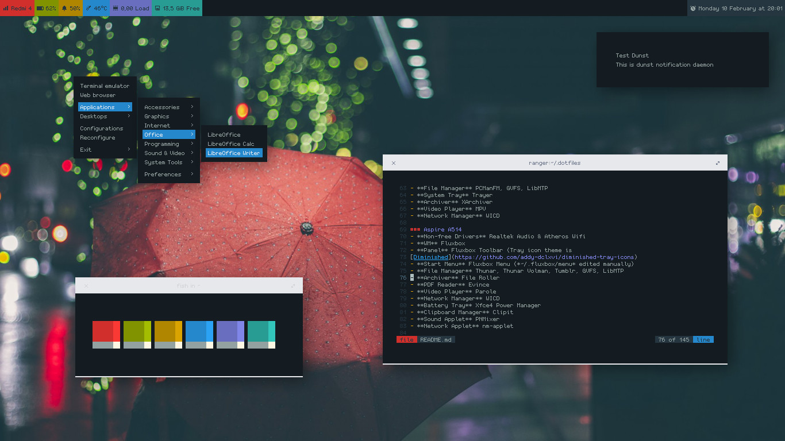

### Aspire A514 — Debian Fluxbox
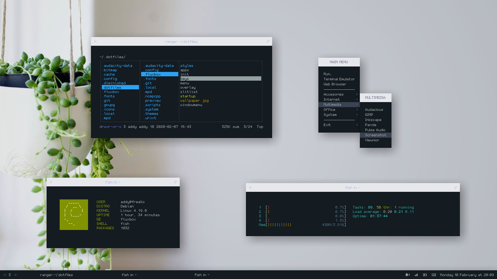

## System & Software Stack

*(Originally configured on Debian Buster; see the [October 2026 updates](#update--october-16-2026) below for newer Debian Trixie branches.)*

### Shared Setup (Both ThinkPad X230 & Aspire A514)

| Component | Package / Tool |
| :--- | :--- |
| **Distro** | Debian Buster |
| **Display Server** | X11 |
| **Display Manager** | LightDM |
| **Greeter** | LightDM GTK Greeter |
| **Desktop Environment** | None |
| **Launcher** | Rofi |
| **Terminal** | URxvt (`rxvt-unicode`) |
| **Compositor** | Compton |
| **GTK Theme** | Arc |
| **Icons** | Faba |
| **Cursor** | Breeze |
| **Web Browser** | Chromium (with VA-API) |
| **VA-API Driver** | `i965-va-driver` |
| **Encoder / Decoder** | FFmpeg (`ffmpeg`) |
| **Task Manager** | `htop` |
| **Power Manager** | TLP |
| **Image Viewer** | Viewnior |
| **Sound Mixer** | PulseAudio |
| **Polkit Frontend** | GNOME Polkit |
| **Notification Daemon** | Dunst |
| **Pager** | `less` |
| **CLI Shell** | Fish |
| **CLI File Manager** | Ranger |
| **CLI Image Viewer** | `libcaca` (`cacaview`) |
| **CLI Text Editor** | Vim |
| **GUI Text Editor** | Geany |
| **Graphics Editor** | GIMP |
| **Vector Editor** | Inkscape |
| **Screenshot Tool** | `scrot` |
| **Wallpaper Setter** | `hsetroot` |
| **Brightness Control** | `xbacklight` |
| **Music Player** | Audacious |
| **Office Suite** | LibreOffice |
| **Printer Driver** | Gutenprint |

### Machine-Specific Components

| Component | ThinkPad X230 | Aspire A514 |
| :--- | :--- | :--- |
| **Non-free Drivers** | Broadcom Bluetooth & Intel Wi-Fi | Realtek Audio & Atheros Wi-Fi |
| **Window Manager** | Openbox | Fluxbox |
| **Panel** | `i3status` piped to Lemonbar | Fluxbox Toolbar (tray icons: [Diminished](https://github.com/addy-dclxvi/diminished-tray-icons)) |
| **Application Menu** | `lxmenu-data` piped to `openbox-menu` | Fluxbox Menu (`~/.fluxbox/menu`, edited manually) |
| **File Manager** | PCManFM, GVfs, `libmtp` | Thunar, `thunar-volman`, Tumbler, GVfs, `libmtp` |
| **Archive Manager** | Xarchiver | File Roller |
| **PDF Viewer** | — | Evince |
| **Video Player** | `mpv` | Parole |
| **Network Manager / Applet** | Wicd | `nm-applet` |
| **Battery Applet** | — | Xfce4 Power Manager |
| **Clipboard Manager** | — | ClipIt |
| **Volume Applet** | — | PNMixer |
| **System Tray** | `trayer` | Built-in Fluxbox Toolbar tray |

## How I Restore My Setup

1. Install minimal Debian Buster without a desktop environment.
2. Enable the `contrib` and `non-free` repositories in `/etc/apt/sources.list`.
3. Connect to the internet.
4. Install Git (`sudo apt install git`).
5. Clone this repository:
   ```bash
   git clone --depth=1 [https://github.com/addy-dclxvi/debian-openbox-fluxbox-dotfiles.git](https://github.com/addy-dclxvi/debian-openbox-fluxbox-dotfiles.git) ~/.dotfiles
   ```
6. Copy the dotfiles into your home directory:
   ```bash
   cp -a ~/.dotfiles/. ~
   ```
7. Install the required packages using the helper script for your window manager:
   ```bash
   sh ~/.scripts/openboxpack
   # or for Fluxbox:
   sh ~/.scripts/fluxboxpack
   ```
8. Add your user to `sudoers` using `visudo` (if `sudo` wasn't configured during installation).
9. Set the system clock to local time (`timedatectl set-local-rtc 1`) and adjust the BIOS clock accordingly (I keep my BIOS clock on local time instead of UTC).
10. Change your default login shell to Fish:
    ```bash
    chsh -s /usr/bin/fish
    ```
11. Review and apply the system configuration examples in `~/.dotfiles/.system`.
12. Reboot, troubleshoot any small quirks that come up, and start working!

## Keybindings & Mouse Actions

### Shared Keybindings (Openbox & Fluxbox)

| Shortcut | Action |
| :--- | :--- |
| `Super + Enter` | Launch URxvt |
| `Super + D` | Launch Rofi (via wrapper script) |
| `Super + Space` | Open the root menu (same as right-clicking the desktop) |
| `Alt + Tab` | Switch to the next window |
| `Alt + Shift + Tab` | Switch to the previous window |
| `Ctrl + Alt + Left/Right` | Switch to the previous or next workspace |
| `Ctrl + Alt + Up/Down` | Switch to the previous or next window (same as `Alt + Tab`) |
| `Super + Arrow` | Snap window to screen edges ("Aero Snap") |
| `Super + 1–4` | Switch to workspaces 1–4 |
| `Super + Shift + 1–4` | Move the focused window to workspaces 1–4 |
| `Super + Shift + Left/Right` | Move the focused window to the previous or next workspace |
| `Super + Alt + Arrow` | Move focus to another window in the chosen direction |
| `Super + Ctrl + Arrow` | Teleport (move) the focused window in the chosen direction |
| `Super + A` | Center the focused window |
| `Super + C` | Close the focused window |
| `Super + Z` | Minimize (iconify) the focused window |
| `Super + F` | Maximize the focused window |
| `Super + T` | Toggle window decorations (titlebar and borders) |
| `Super + U` | Roll up (shade) the focused window |
| `Super + Shift + Backspace` | Reload window manager configuration (run after editing config files) |

For the full list of keybindings, check `~/.config/openbox/rc.xml` or `~/.fluxbox/keys`.

### Mouse Actions

| Action | Behavior |
| :--- | :--- |
| **Double-click titlebar** | Maximize window |
| **Scroll up on titlebar** | Roll up (shade) window |
| **Scroll down on titlebar** | Unroll (unshade) window |
| **Double-click desktop** *(Openbox only)* | Show a list of open windows (handy for navigating without a taskbar) |
| **Hold `Ctrl` + drag window** *(Fluxbox only)* | Group windows into tabs |
| **Scroll up/down on volume (panel)** | Increase or decrease volume |

### Lemonbar Click Actions (Openbox Only)

| Panel Module | Action |
| :--- | :--- |
| **Disk** | Open PCManFM |
| **Volume** | Open `pavucontrol` |
| **SSID** | Open Wicd |
| **CPU Load** | Open `htop` |

## Notes

- If you plan to use these dotfiles, please inspect the configuration files before applying them.
- Replace any occurrences of `addy` in the configuration files with your own username.
- Network interface names depend on your hardware—if you spot them in the config files, replace them with yours (run `ip a` to check your interface names):
  - **ThinkPad X230:** Wi-Fi is `wlp3s0`, Ethernet is `enp0s25`
  - **Aspire A514:** Wi-Fi is `wlp2s0`, Ethernet is `enp1s0`

---

## Update — 16 October 2026

Most of the package list above is now outdated, as quite a lot has changed! I've pushed this updated setup to the [`trixie-fluxbox`](https://github.com/addy-dclxvi/debian-openbox-fluxbox-dotfiles/tree/trixie-fluxbox) branch.

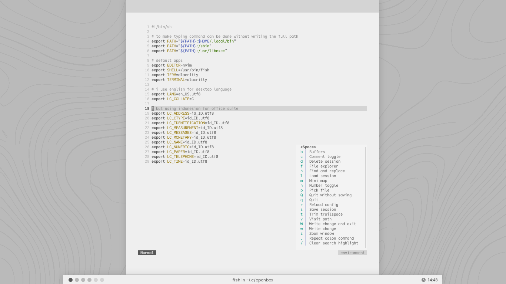
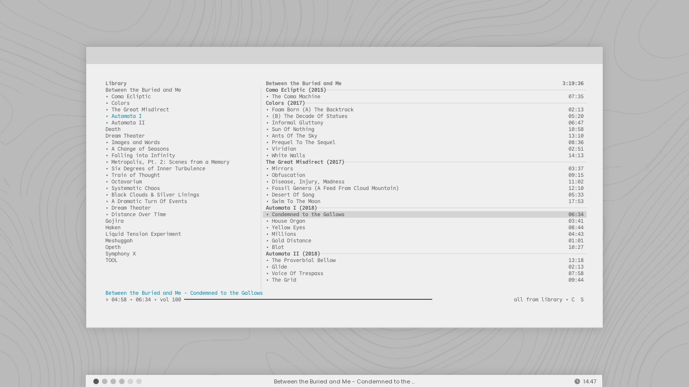
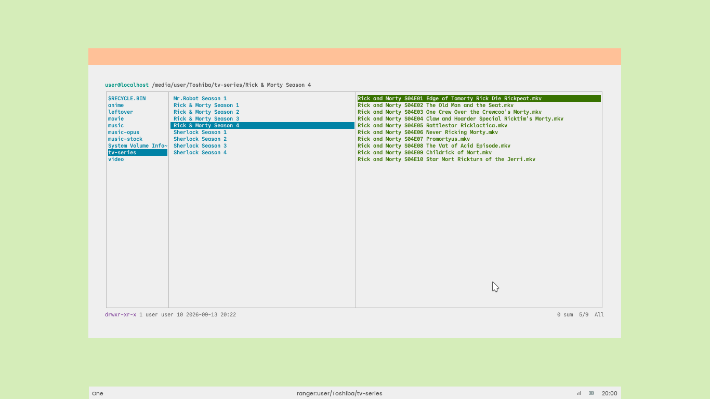
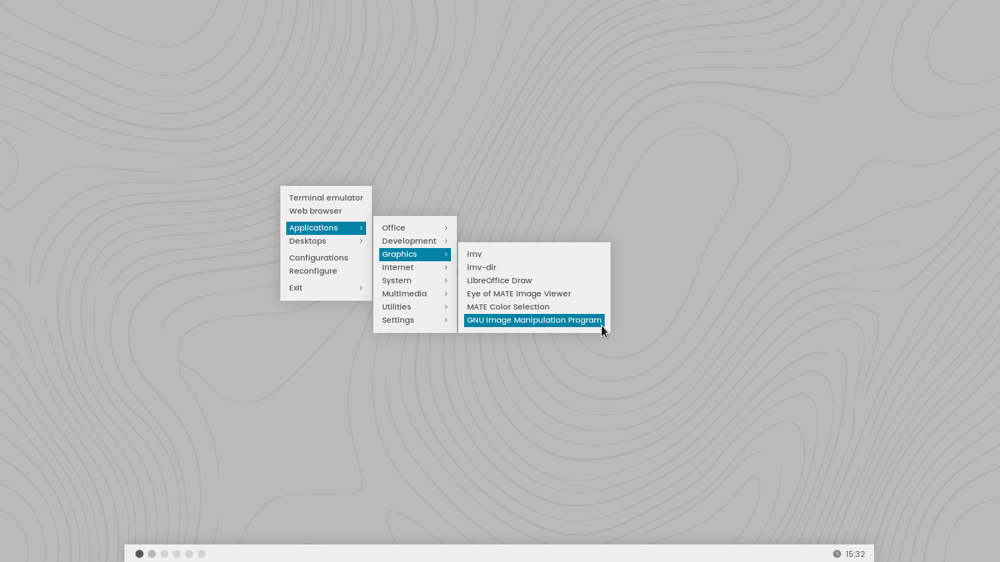
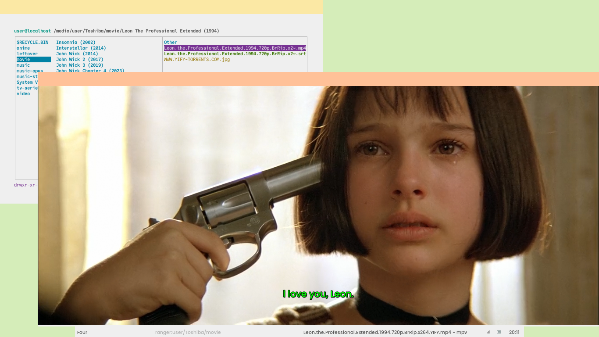

- **Terminal:** Alacritty
- **Text Editor:** Neovim — I'm not a programmer, so there's nothing fancy like LSPs or linters here; just a lightweight setup for basic text editing. The only plugin I use is `mini.nvim`. Because I use Debian Stable (where Neovim stays on a fixed version), I keep a backup copy of the plugin in this repository so I can restore a compatible release if upstream ever bumps its minimum Neovim requirement.
- **File Manager:** Ranger
- **Music Player:** `cmus`
- **Media Player:** `mpv`

## Update — 29 October 2026

I've pushed the updated Openbox configuration to the [`trixie-openbox`](https://github.com/addy-dclxvi/debian-openbox-fluxbox-dotfiles/tree/trixie-openbox) branch. The CLI file manager is now `lf` paired with `ueberzug` for image previews.


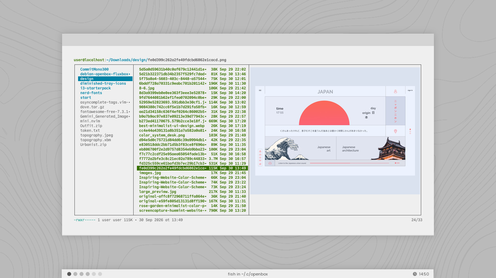
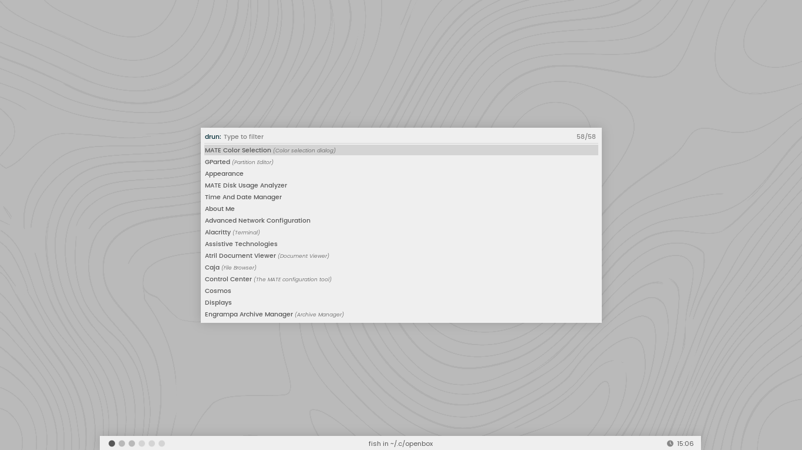

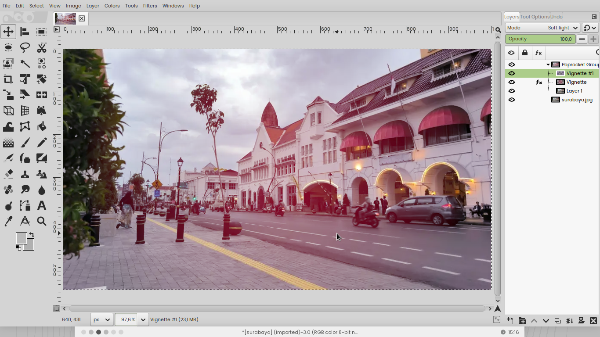
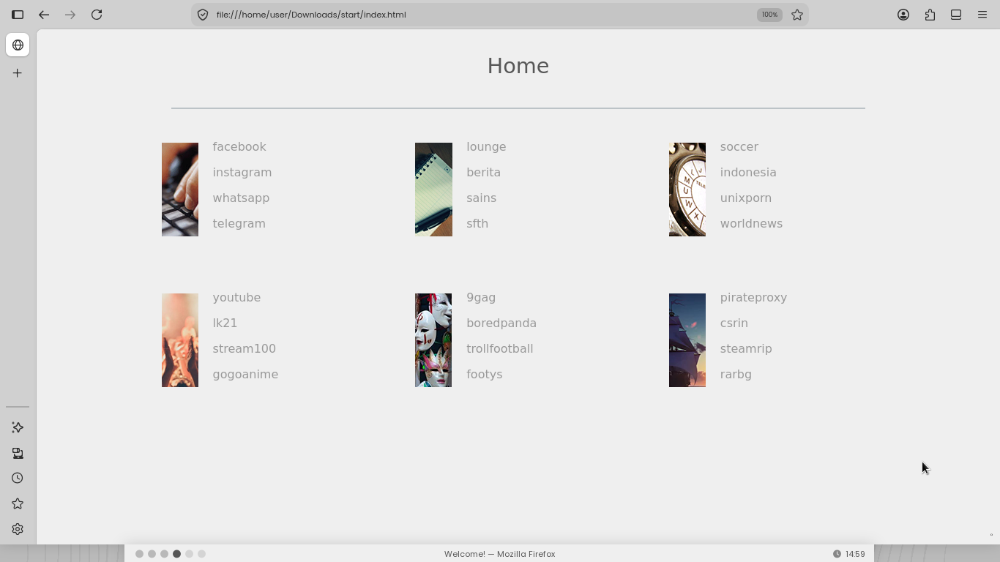

